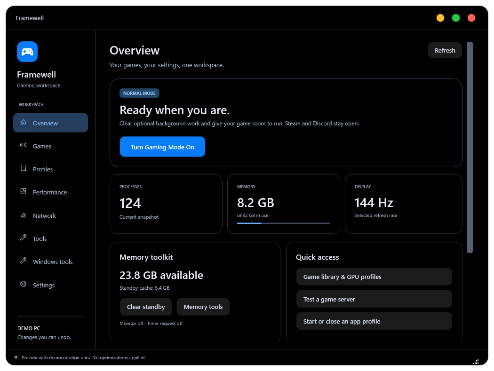
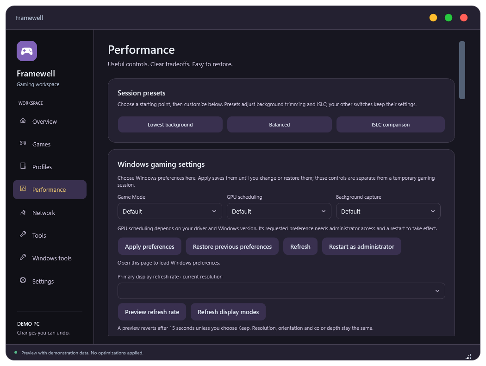
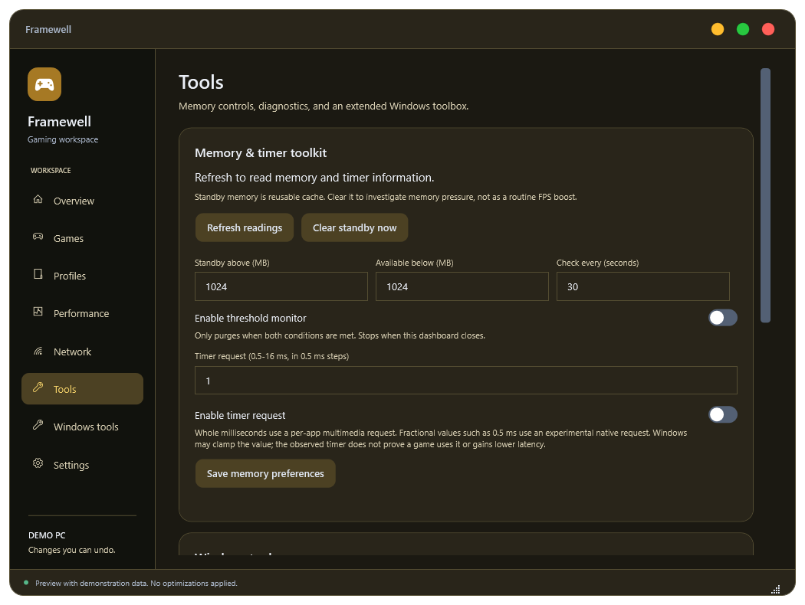

<div align="center">

# Framewell

A configurable Windows dashboard for gaming sessions, app profiles, performance experiments, and system tools.


**[Download for Windows](https://github.com/ezeustech/framewell/releases/download/v3.2.0/Framewell-3.2.0-win-x64.zip)** · [Get started](#get-started) · [Features](#features) · [Build](#build-from-source) · [AI transparency](AI_TRANSPARENCY.md) · [Technical guide](docs/ARCHITECTURE.md)

</div>

Framewell brings session controls and Windows tools into one desktop app. Choose what closes while you play, restore supported apps afterward, tune individual games, and keep separate configurations for different tasks. The interface uses compact widgets, a restrained layout, and 33 selectable color palettes.

**Version 3.2 adds background updates and smoother navigation.** System reads run separately from the interface, window controls are larger and positioned at the top right, and updates install after you close the app. Extract the ZIP and double-click `Framewell.exe` to start.

**Optimizer runs directly inside the app.** Its Windows tools run in the same process, with embedded navigation and native dialogs. NVIDIA Control Panel remains available as an external vendor tool.

This is an **unsigned, early-stage project**. It has been developed and tested on one Windows 11 PC with isolated regression tests; broad hardware and game compatibility has not been established. There are no promised FPS gains or universal “best settings.”

## Preview



*Actual interface rendered with demonstration data. Preview values are illustrative, not benchmark results.*

<details>
<summary>Windows controls and a character-inspired theme</summary>





</details>

## Features

| Area | What you can do |
| --- | --- |
| Sessions | Close selected background apps, activate a gaming session, and restore supported prior state from a journal. Steam, Discord, active games, and essential system processes have protection rules. |
| App profiles | Keep Media stack and Super Performance profiles, create your own collections, and launch or close selected apps. New installations contain no personal media-server configuration. |
| Game library | Find supported launcher libraries, scan additional folders, add an EXE manually, and bind the actual game process. Discovery is bounded; arbitrary portable games may need manual addition. |
| Per-game controls | Select CPU priority and logical processors. Apply supported NVIDIA Performance, Quality, or custom settings to eligible individual game profiles; restore previous values separately. |
| Memory | Inspect RAM and standby cache, run a manual purge, or enable a threshold-based monitor. Timer-resolution requests are optional experiments and stop when the app closes. |
| Network | Test ICMP round-trip or TCP connection time against a chosen endpoint, save servers, inspect running-game TCP connections, and compare equivalent tests. |
| Windows controls | Manage Game Mode, background capture, GPU scheduling preference, per-EXE GPU preference, and primary-display refresh rate inside the app. Refresh previews require confirmation and otherwise revert. |
| Embedded Windows tools | Access 16 sections adapted from Optimizer 17.0, including Windows tweaks, startup, installed apps, cleanup, DNS/ping, HOSTS, registry tools, context menus, hardware, file handles, disk activity, and CPU/process controls. |
| Personalization | Save whole-app or tab settings profiles, choose optional dashboard startup, and select light, dark, OLED, or fan-inspired JoJo palettes. |
| Updates | Check official GitHub releases automatically at startup, verify downloads with SHA-256, and install after closing. Turn automatic updates off in Settings or check manually. |

The dashboard refreshes on demand. It installs no permanent background service. Optional memory monitoring and explicit diagnostics run only when selected; embedded tools load on demand and can be unloaded.

## Get started

1. **[Download Framewell for Windows](https://github.com/ezeustech/framewell/releases/download/v3.2.0/Framewell-3.2.0-win-x64.zip).** Choose the `win-x64.zip` release asset.
2. **Extract the entire ZIP** to a writable local folder, such as a folder in Documents. Use Windows **Extract All** rather than opening the EXE inside the ZIP.
3. **Double-click `Framewell.exe`.** Keep the `app` folder beside it.

```text
Framewell.exe       ← open this
START HERE.txt
app/                ← included support files; keep this folder
```

No installer, compilation, PowerShell command, or administrator approval is needed just to open the dashboard. Choose your apps and profiles before turning Gaming Mode on. Add games the scanner misses with **Add EXE** or **Scan folder**. Individual system-changing actions may request Windows administrator approval when selected.

**Supported platform:** Windows 11 x64, or Windows 10 version 1903 or later with **.NET Framework 4.8+** and **Windows PowerShell 5.1** available. These runtimes are included in standard installations of those Windows versions. NVIDIA features need a compatible GPU and installed driver; FPS capture needs a supported PresentMon installation. Individual Windows tools have additional OS and privilege requirements. The portable build is unsigned, so Windows may show a publisher/reputation warning.

**Automatic updates are enabled by default.** Settings contains the toggle, manual check, and download controls. Newer stable releases download in the background and install after you close Framewell; the next launch opens the updated version. Profiles, preferences, and restore journals stay in place. There is no updater service or scheduled task. See [update behavior and recovery](docs/UPDATES.md).

For an offline or manual update, close Framewell and extract the new portable ZIP into the same folder, keeping your existing `app/state` folder. Profiles from the older Gaming Mode layout remain compatible; see [upgrading and local state](docs/ARCHITECTURE.md#state-and-packaging). Never upload a personal state folder to a public issue.

## Know what each control changes

- **Session Restore** handles the session journal. Windows tools, NVIDIA profiles, and other persistent changes have separate restore controls and limitations. It is not a system-wide undo button.
- **Memory cleanup is optional.** Standby cache is reusable RAM; purging it can increase later disk reads. Timer requests and CPU affinity can hurt performance on some games.
- **Network tests are endpoint diagnostics.** ICMP/TCP timings are not a game's UDP ping counter, a bandwidth test, or a guaranteed measure of gameplay packet loss.
- **Windows tools can make persistent changes.** Review each operation, particularly uninstall, cleanup, registry, service, HOSTS, and process-blocking actions. Some operations require a restart or have no automatic undo.
- **Quality and performance presets express tradeoffs.** They cannot configure every engine's graphics, DLSS, ray tracing, or Reflex. Compare real gameplay on your hardware.

See [behavior and limitations](docs/LIMITATIONS.md) and [validation](docs/VALIDATION.md) for the implementation's practical boundaries.

## Build from source

Use **64-bit Windows PowerShell 5.1**, not PowerShell 7, for the build:

```powershell
powershell.exe -NoProfile -ExecutionPolicy Bypass -File .\Build-EmbeddedOptimizer.ps1
powershell.exe -NoProfile -ExecutionPolicy Bypass -File .\Build-Launcher.ps1
powershell.exe -NoProfile -ExecutionPolicy Bypass -File .\Build-Release.ps1
```

The embedded component build downloads Microsoft's pinned Roslyn 4.8 compiler package from NuGet and verifies its SHA-256 before extraction. The launcher uses the installed .NET Framework compiler. Output archives and checksums are written to `dist`.

The complete modified Optimizer source is under `vendor/optimizer/embedded-source/optimizer-17.0`. Portable releases include that source as `app/vendor/optimizer/embedded-source.zip`; source releases include the editable tree and build scripts. The original upstream archive and provenance are also retained.

Packaging uses an explicit runtime allowlist. Personal profiles, media configuration, credentials, restore journals, logs, and cached game paths are excluded. See [architecture](docs/ARCHITECTURE.md) for component boundaries and [contributing](CONTRIBUTING.md) for testing expectations.

## AI transparency

This project was built with substantial assistance from OpenAI's Codex/ChatGPT. AI contributed implementation, interface design, documentation, and test development based on the owner's requirements. AI-generated work can contain errors; passing automated checks does not replace independent review or testing on other hardware. See [AI_TRANSPARENCY.md](AI_TRANSPARENCY.md) for scope, evidence, and limitations.

The app does not require an AI account and does not send your game library or settings to an AI service. Optional network diagnostics and selected upstream tools communicate with their respective endpoints.

## Credits and license

The combined Framewell distribution is licensed under **GPL-3.0**, with component notices preserved. The embedded Windows tools are a modified integration of [Optimizer by hellzerg and contributors](https://github.com/hellzerg/optimizer), not an independently invented replacement. Earlier original Gaming Mode code retains its MIT notice; see [LICENSE.txt](LICENSE.txt), [LICENSE-ORIGINAL-MIT.txt](LICENSE-ORIGINAL-MIT.txt), and [THIRD-PARTY-NOTICES.txt](THIRD-PARTY-NOTICES.txt).

This project is not affiliated with or endorsed by Microsoft, NVIDIA, Apple, Optimizer's maintainers, or the franchises referenced by its color themes. No character artwork, proprietary driver, ISLC binary, or game content is bundled.
